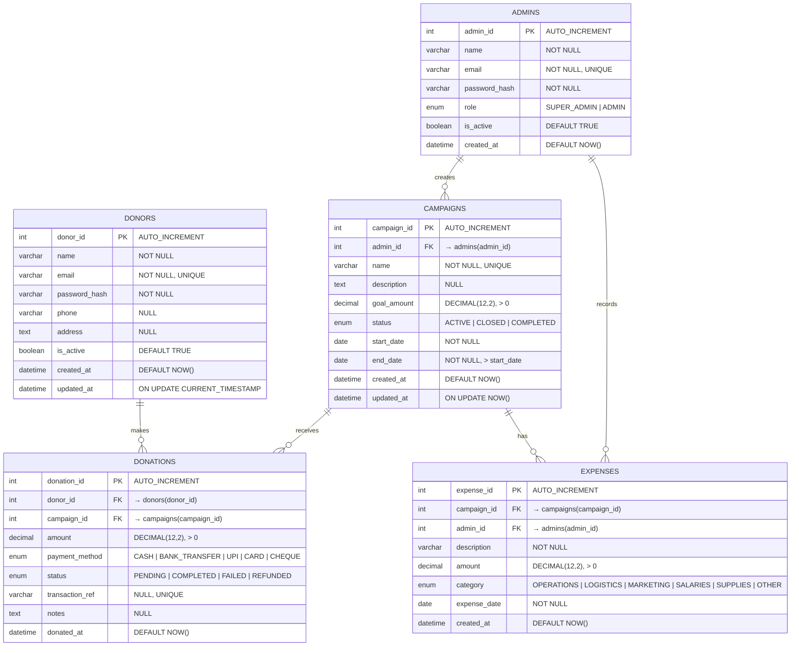

# ER Diagram — NGO Donation Management System

---

## Entity-Relationship Diagram (Mermaid)

---

## Relationship Descriptions

| Relationship | Notation | Meaning |
|-------------|----------|---------|
| `ADMINS` → `CAMPAIGNS` | `\|\|--o{` | One admin creates zero or more campaigns. Each campaign belongs to exactly one admin. |
| `ADMINS` → `EXPENSES` | `\|\|--o{` | One admin records zero or more expenses. Each expense is recorded by exactly one admin. |
| `DONORS` → `DONATIONS` | `\|\|--o{` | One donor makes zero or more donations. Each donation belongs to exactly one donor. |
| `CAMPAIGNS` → `DONATIONS` | `\|\|--o{` | One campaign receives zero or more donations. Each donation targets exactly one campaign. |
| `CAMPAIGNS` → `EXPENSES` | `\|\|--o{` | One campaign has zero or more expenses. Each expense belongs to exactly one campaign. |

---

## Key Legend

| Symbol | Meaning |
|--------|---------|
| `PK` | Primary Key |
| `FK` | Foreign Key |
| `\|\|` | Exactly one (mandatory) |
| `o{` | Zero or more (optional many) |

---

## Computed Values (Not in Diagram — Derived at Query Time)

These are **not stored columns**; they are calculated dynamically using SQL:

| Value | Formula |
|-------|---------|
| `total_collected` | `COALESCE(SUM(amount), 0.00) FROM donations WHERE campaign_id = ? AND status = 'COMPLETED'` |
| `total_spent` | `COALESCE(SUM(amount), 0.00) FROM expenses WHERE campaign_id = ?` |
| `available_funds` | `total_collected − total_spent` |

> **Note:** `COALESCE(..., 0.00)` is mandatory. `SUM()` returns `NULL` when no rows match;
> without `COALESCE`, the `available_funds` formula produces `NULL` instead of `0.00`
> for a new campaign with no donations or expenses yet.

---

*Document version: 1.1 | Phase: 1 — Planning (reviewed & corrected)*
